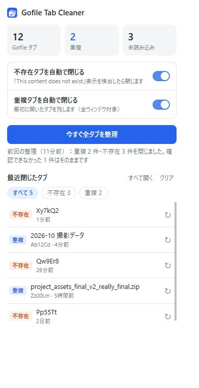

# Gofile Tab Cleaner

Gofile のコンテンツタブ（`https://gofile.io/d/<contentId>`）を整理する Chrome 拡張機能です。

- **不存在タブの自動クローズ**：削除済み・存在しないコンテンツのタブを閉じます
- **重複タブの整理**：同じコンテンツのタブが複数あれば、最初に開いたタブだけを残します

> 非公式のツールです。Gofile（WOJTEK SAS）とは関係ありません。

## インストール

Chrome ウェブストアには公開していないので、手動で読み込みます（Chrome / Edge / Brave など Chromium 系ブラウザで動作）。

1. [Releases](https://github.com/Hoyomaru/gofile-tab-cleaner/releases/latest) から `gofile-tab-cleaner-v<バージョン>.zip` をダウンロードして展開する
2. Chrome で `chrome://extensions` を開く
3. 右上の「デベロッパー モード」をオンにする
4. 「パッケージ化されていない拡張機能を読み込む」で、展開してできた `gofile-tab-cleaner` フォルダを選ぶ

展開したフォルダは削除・移動しないでください（拡張機能はそのフォルダから読み込まれます）。

### 更新

1. 新しいバージョンの ZIP を展開し、前のフォルダの中身を置き換える
2. `chrome://extensions` でこの拡張機能の再読み込み（↻）を押す

設定と履歴はそのまま引き継がれます。新しいバージョンの通知を受け取るには、リポジトリの「Watch → Custom → Releases」を設定してください。

## 使い方

- **自動**：タブを開く・読み込むと自動で処理します（ポップアップのスイッチで個別にオフにできます）
- **手動**：ツールバーのアイコン →「今すぐ全タブを整理」。整理中は進捗バーを表示します
- ポップアップ上部に、今開いている Gofile タブ数・重複数・未読み込み数を表示します
- 閉じたタブは「最近閉じたタブ」に50件まで残ります
  - 保存期間（1日 / 3日 / 7日 / 30日 / 無期限、初期値は7日）を過ぎた履歴は自動で消えます
  - 「不存在 / 重複」で絞り込めます
  - ↻ で開き直せます（同じコンテンツのタブが既に開いていれば、そのタブへ移動）
  - 「すべて開く」で表示中の履歴をまとめて開き直せます。開き直した分は履歴から消えます

## 判定のしくみ

### 不存在

ページを読み込んだ後、次の **両方** がそろった時だけ「明確に不存在」とみなして閉じます。

- タブのタイトルが `Content not found · Gofile`
- ページの見出しが `This content does not exist`

### 重複

URL の `/d/` の後ろ（contentId）が同じタブを重複とみなします。クエリ（`?…`）やハッシュ（`#…`）は無視し、大文字小文字は区別します。全ウィンドウが対象です。

## 安全のための決まり

- ピン留めタブは閉じません（重複時はピン留めを優先して残します）
- 未読み込み・休止中のタブは、自動処理では触りません。手動整理の時だけ再読み込みして確認します（同時に3タブずつ、1タブ最大約45秒）
  - 存在していたタブは、表示中でなければ休止状態に戻します
  - 時間内に不存在表示が出なければ閉じません
- 判定後に別のページへ移動していたタブは閉じません
- 「最初に開いたタブ」はタブ ID の小ささで判断します（ブラウザ再起動後は復元順になります）

## 必要な権限

| 権限 | 用途 |
| --- | --- |
| `tabs` | Gofile タブの URL を見て、重複・不存在のタブを閉じる |
| `scripting` | 手動整理の時、タブの表示内容を確認する |
| `storage` | 設定と「最近閉じたタブ」の履歴を保存する（外部には送信しません） |
| `alarms` | 保存期間を過ぎた履歴を1時間ごとに削除する |
| `gofile.io` へのアクセス | 不存在表示の検出 |

## 開発メモ

- アイコンは `pwsh tools/make-icons.ps1` で `icons/` に再生成できます（Windows）
- リリース用 ZIP は `pwsh tools/make-release.ps1` で `dist/` に作れます（バージョンは `manifest.json` から取得）
- Gofile の画面の文言が変わると不存在判定が動かなくなります。その場合は `common.js` と `content.js` の判定条件を合わせて直してください

## ライセンス

[MIT](LICENSE)
